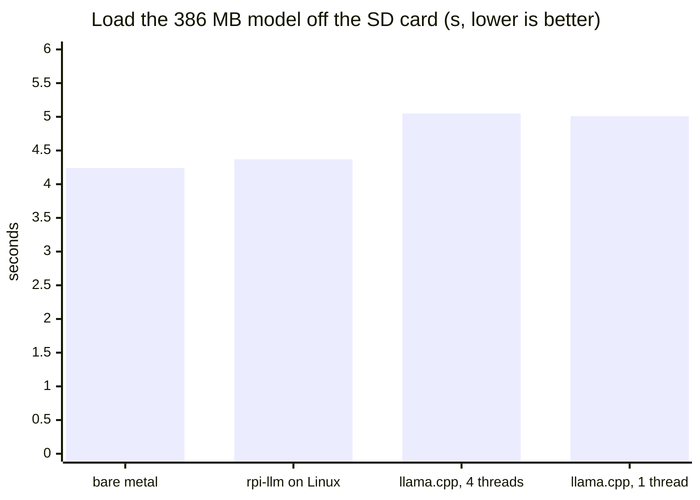
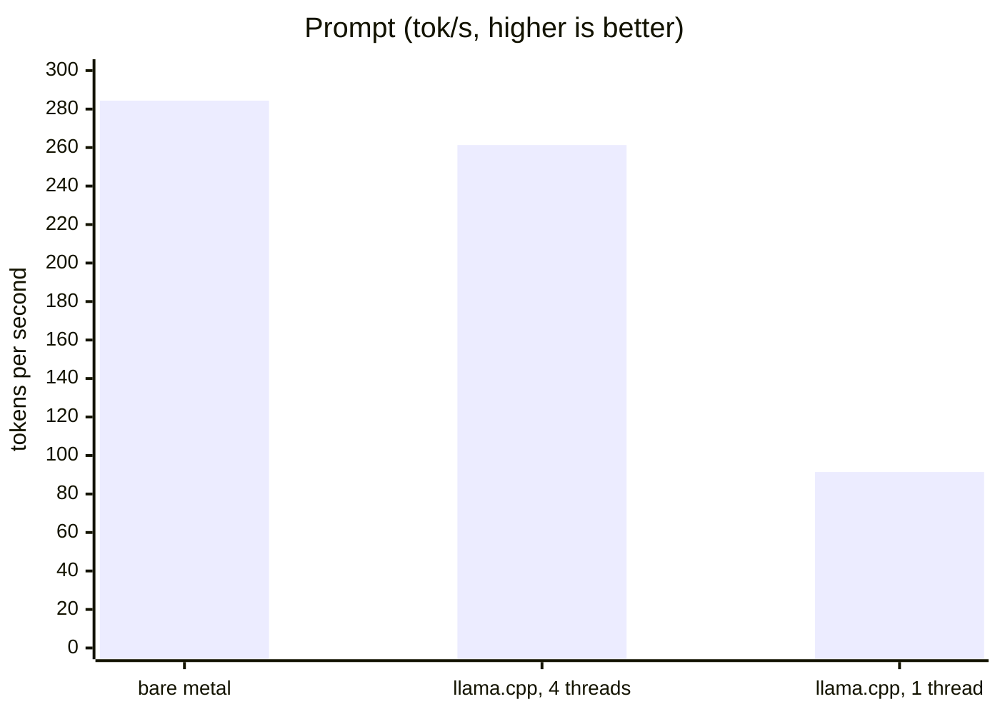
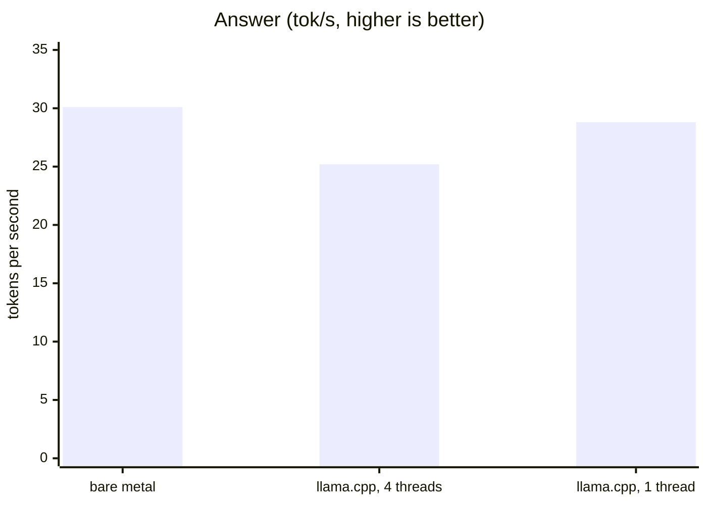

# rpi-llm

rpi-hal baremetal LLM chat engine: a small language model running on a
Raspberry Pi 5 with no operating system, chatting over the serial
console. See [plan.md](plan.md) for the design, what is still to come,
and why.

Today it loads [SmolLM2-360M-Instruct](https://huggingface.co/HuggingFaceTB/SmolLM2-360M-Instruct)
(a Q8_0 GGUF file) off the SD card, answers one fixed chat request on all
four cores, streams the answer to the serial console, and checks it token
for token against what the same engine produces on a development
machine. It is a bare-metal Rust program on
[rpi-hal](https://crates.io/crates/rpi-hal) and
[rpi-kickstart](https://crates.io/crates/rpi-kickstart).

The model side — the GGUF reader, the tokenizer, Q8_0 arithmetic with
NEON `sdot`, the transformer itself — is the `rpi-llm-engine` crate in
[engine/](engine/), which has no hardware in it and is tested on the host
against llama.cpp and llama2.c (`make test`).

## What you need

- A Raspberry Pi 5.
- A USB-to-serial cable (3.3 V): its RX on GPIO14 (pin 8), its TX on
  GPIO15 (pin 10), and ground on pin 6. The console runs at 115200 8N1.
- An SD card with one FAT32 partition, 1 GB or more.
- Rust via [rustup](https://rustup.rs). `rust-toolchain.toml` installs
  the right toolchain and target on first build.
- `cargo install cargo-binutils rpi-loader`: `cargo objcopy` turns the
  build into the raw image the firmware loads, and `rpi-loader` uploads
  it to the board.

## Set up the card, once

```sh
make sd-card
make models
```

`make sd-card` fetches the [rpi-loader](https://github.com/joeferner/rpi-hal/tree/main/loader)
image into `sd-card/` (a Pi 5 needs no boot firmware files; its firmware
lives in its EEPROM), checking it against `sd-card.sha256`. Copy
everything in `sd-card/` onto the card's boot partition, including
`config.txt`. The loader goes on the card as `kernel8.img`, the only
filename the firmware loads on this board, and stays resident.

`make models` fetches the model files into `models/`, checking each
against `models.sha256`. Copy `smollm2-360m-instruct-q8_0.gguf` onto the
card as `models/smollm2-360m-instruct-q8_0.gguf`.

## Build and run

```sh
make run DEVICE=/dev/ttyUSB0
```

This builds `target/kernel8.img`, uploads it to the board over the serial
cable, and boots it. On the same cable it shows the model loading, then
the chat request and the answer as it is generated, then how fast each
part ran:

```
models/smollm2-360m-instruct-q8_0.gguf: 368.5 / 368.5 MiB [####...####] 100%  91.0 MB/s
[    4.774] models/smollm2-360m-instruct-q8_0.gguf: 386404992 bytes in 4.24 s, 91.0 MB/s
...
<|im_start|>user
Write a short story about a robot who learns to paint.<|im_end|>
<|im_start|>assistant
Once upon a time, there was a robot named Robo who was very smart ...
[   13.560] chat: prompt 42 tokens in 0.15 s, 284.4 tok/s
[   13.563] chat: answer 200 tokens in 6.60 s, 30.1 tok/s
[   13.569] phases: prompt: 1 calls in 147.6 ms: quantize 8.4, matmul 113.6, attention 6.3, other 19.3
[   13.578] phases: answer: 199 calls in 6585.6 ms: quantize 114.5, matmul 5884.4, attention 421.9, other 164.8
...
[   13.613] reference: all 200 tokens match the host engine
```

`make test` runs the engine's tests on the development machine (the
ones that need model files skip without `make models`). `make test-arm`
runs the same tests built for 64-bit Arm under `qemu-aarch64`, so the
NEON code the board runs is checked against the same references (it
needs `qemu-aarch64` and `rustup target add aarch64-unknown-linux-musl`,
and takes about ten minutes). `make bandwidth`
runs a memory bandwidth measurement on the board instead of the model,
and `make kernel` times the prompt's matrix multiply kernel alone, in
cycles per 4-row by 4-token block (about 30 on one core or four, with
the tokens in L1 or not).

## Performance

SmolLM2-360M-Instruct, Q8_0, answering the same chat request greedily
(42 prompt tokens, 200 answer tokens), on one Raspberry Pi 5 (8 GB) at
2.4 GHz, reading the model off the same SD card; the Linux rows measured
2026-10-20 and the bare-metal row 2026-10-21:

| | Load | Prompt | Answer |
|---|---|---|---|
| rpi-llm, bare metal, 4 cores | **4.24 s (91.0 MB/s)** | **284.4 tok/s** | **30.1 tok/s** |
| rpi-llm, Linux, 4 threads | 4.37 s (88 MB/s) | 27.6 tok/s | 25.9 tok/s |
| rpi-llm, Linux, 1 thread | 4.42 s | 26.0 tok/s | 22.3 tok/s |
| llama.cpp, Linux, 4 threads | 5.05 s (77 MB/s) | 261.3 tok/s | 25.2 tok/s |
| llama.cpp, Linux, 1 thread | 5.01 s | 91.4 tok/s | 28.8 tok/s |

The same three as charts: the load as a time (lower is better), the
prompt and the answer as rates (higher is better). The `rpi-llm` Linux
rows are left out of the rate charts: they predate the engine's batching
and kernels (see below).







- **Load** is the whole 386 MB model read off the SD card into RAM: the
  page cache dropped before each Linux run, and llama.cpp's mmap off so
  that it really reads the file (its time includes repacking the weights
  for its own kernels). Every row read the same card, the bare-metal one
  from its FAT boot partition (512-byte clusters) and Linux from ext4.
  On another card, a slower one, the bare-metal load took 5.37 s (71.9
  MB/s): the card sets the rate, not the driver, which reads both at
  about 95% of what `rpi-hal`'s `sd_speed` example measures them at.
- **Prompt** is the prompt's tokens until the first answer token; **answer**
  is the answer's tokens after that.
- Linux is Raspberry Pi OS (Debian 13, kernel 6.18) with the `performance`
  CPU governor; nothing throttled. llama.cpp is commit `0ce8cd1` with its
  defaults; `rpi-llm` on Linux is the same engine as the board's, built as
  an ordinary program ([bench/](bench/)).
- The `rpi-llm` Linux rows were measured before the engine batched its
  prompt; the bare-metal row is with batching, the 4x4 and then 4x8
  kernels, the per-token work spread across the cores and NEON attention
  (it was 28.5 tok/s for the prompt and 25.5 for the answer before all
  of them).
- The `phases:` lines split the time inside the model: quantizing
  activations to 8 bits, the weight matrix multiplies, attention, and
  everything else (normalization, RoPE, SwiGLU, residual adds).
- The whole prompt, its last token included, runs through the model as
  one batch, and only the last token's row goes through the classifier.
  The `arm:` lines around it log the measured clock, the temperature and
  the firmware's throttling word, since the prompt is the run's hardest
  burst.

What the numbers say:

- **Bare metal is ahead on all three.** The load by 3% over the same
  engine on Linux and 16% over llama.cpp, the prompt by 9% and the
  answer by 4.5% over llama.cpp's best.
- **Generation is a little ahead.** Every configuration meets the same
  limit, the memory: a token reads every weight once, and four cores together
  read at most 13.9 GB/s (one alone reads 14.0), which `make bandwidth`
  measures. Splitting each matrix's rows across the cores in interleaved
  4 KiB chunks rather than contiguous quarters is what gets near that.
- **The prompt is 1.1x ahead of llama.cpp.** Both push all the prompt's
  tokens through each weight matrix together, so each weight is read once
  for the whole prompt, and both use the same kernel layout: four rows'
  weights interleaved so that one `sdot` serves four rows of one token, in
  tiles of 4 rows by 4 tokens. Batching took this engine from 28.5 to
  89.9 tok/s and the kernel to 106.5. The phase timing then showed most
  of the rest running on core 0 alone: quantizing the activations, and
  the per-token normalization, RoPE and SwiGLU. Moving those onto all
  four cores, quantizing each shared input once, and rounding with the
  hardware's instruction took it to 203.3. Attention in NEON, with the
  prompt's (token, head) pairs dealt out one at a time so that the
  longest histories don't all land on one core, took it to 231.0.
  Widening the kernel's tile to 4 rows by 8 tokens, so that its `sdot`s
  run as eight independent chains rather than four, took it to 241.3.
  Running the prompt's last token in the batch too, rather than through
  the single-token path that reads every weight for it alone, took it to
  287.7 (284.4 in the run above); the matrix multiplies are now three
  quarters of the prompt's time.
- **The load is ahead of Linux's.** rpi-hal's SD driver went from
  default speed (11.7 MB/s, 32.9 s) to UHS-I SDR104 (91.0 MB/s, 4.24 s):
  the card at 1.8V signalling and 200 MHz with a tuned sampling point,
  as Linux runs it. From power-on, the board is ready for the prompt in
  6.75 s, with 1.9 s of that after the load: hashing the file to check it
  (1.4 s) and repacking the weights (0.5 s), both still on one core
  after the read rather than alongside it.

To reproduce the Linux rows, on a Pi 5 running Raspberry Pi OS (64-bit)
with this repository cloned:

```sh
sudo apt install git cmake g++ curl
curl --proto '=https' -sSf https://sh.rustup.rs | sh && . ~/.cargo/env
bench/linux/run.sh
```

It builds llama.cpp at that commit with
[a small patch](bench/linux/llama-simple.patch) for the timing, fetches and
checks the model, runs both programs at 4 and 1 threads, and prints the
table, keeping the logs under `~/rpi-llm-bench/`.
